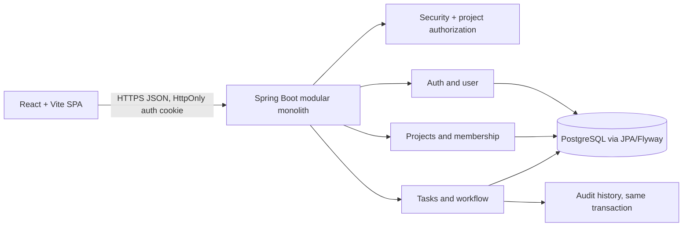

# Architecture

The browser calls a centralized Axios client. Controllers validate DTOs, services enforce permissions and business rules, repositories persist entities, and a centralized exception handler emits safe errors. The authenticated actor comes from the security context. Task updates and audit entries share a transaction; `@Version` detects stale writes.

Project UI reads are served by the membership-scoped project overview and analytics endpoints. Analytics are derived from task rows and the existing task audit log; they add no tables. Profile edits are authenticated through `/api/v1/users/me`. Project members can be removed through the membership endpoint, with owner/admin checks in `ProjectService`. Reusable demo accounts are created only by `DemoUserSeeder` under the explicit `demo` Spring profile.
