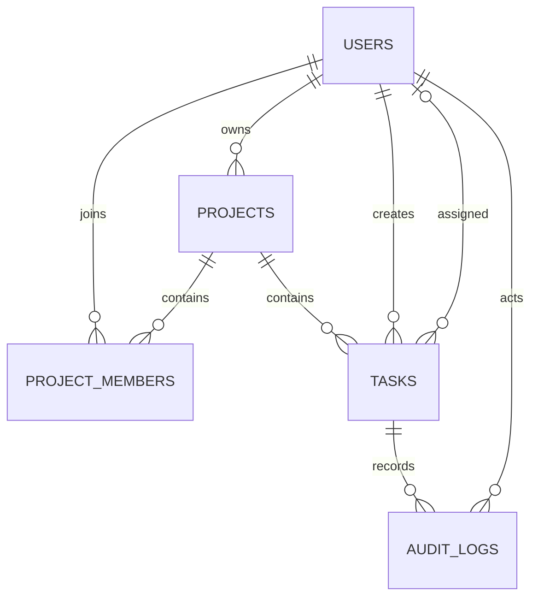

# Database design

TeamFlow uses PostgreSQL. Flyway owns schema creation and upgrades; Hibernate validates the mapped model at startup (`ddl-auto: validate`) and does not create tables. The current schema is migration `V1__initial_schema.sql`.

## Entity relationships

## Tables

### `users`

| Column | Type | Notes |
|---|---|---|
| `id` | `BIGSERIAL` | Primary key. |
| `name` | `VARCHAR(100)` | Required. |
| `email` | `VARCHAR(254)` | Required and unique; application normalizes to lowercase. |
| `password_hash` | `VARCHAR(100)` | Required BCrypt hash; raw passwords are not stored. |
| `created_at`, `updated_at` | `TIMESTAMPTZ` | Required timestamps. |

### `projects`

| Column | Type | Notes |
|---|---|---|
| `id` | `BIGSERIAL` | Primary key. |
| `name` | `VARCHAR(120)` | Required. |
| `description` | `VARCHAR(2000)` | Optional. |
| `owner_id` | `BIGINT` | Required foreign key to `users.id`. |
| `created_at`, `updated_at` | `TIMESTAMPTZ` | Required timestamps. |

### `project_members`

| Column | Type | Notes |
|---|---|---|
| `project_id` | `BIGINT` | Foreign key to `projects.id`. |
| `user_id` | `BIGINT` | Foreign key to `users.id`. |
| `role` | `VARCHAR(20)` | Required; CHECK constraint allows `OWNER`, `ADMIN`, `MEMBER`. |
| `joined_at` | `TIMESTAMPTZ` | Required timestamp. |

Primary key is `(project_id, user_id)`. An index on `(user_id, project_id)` supports finding a user's projects.

### `tasks`

| Column | Type | Notes |
|---|---|---|
| `id` | `BIGSERIAL` | Primary key. |
| `project_id` | `BIGINT` | Required foreign key to `projects.id`. |
| `title` | `VARCHAR(180)` | Required. |
| `description` | `VARCHAR(5000)` | Optional. |
| `status` | `VARCHAR(20)` | Required; `TODO`, `IN_PROGRESS`, `IN_REVIEW`, or `DONE`. |
| `priority` | `VARCHAR(20)` | Required; `LOW`, `MEDIUM`, `HIGH`, or `URGENT`. |
| `assignee_id` | `BIGINT` | Optional foreign key to `users.id`; service verifies project membership. |
| `created_by` | `BIGINT` | Required foreign key to `users.id`. |
| `due_date` | `DATE` | Optional. |
| `version` | `BIGINT` | Required optimistic-lock version. |
| `created_at`, `updated_at` | `TIMESTAMPTZ` | Required timestamps. |

Indexes support project/status ordering, project/priority filters, and project/assignee filters.

### `audit_logs`

| Column | Type | Notes |
|---|---|---|
| `id` | `BIGSERIAL` | Primary key. |
| `project_id` | `BIGINT` | Required foreign key to `projects.id`. |
| `task_id` | `BIGINT` | Required foreign key to `tasks.id`. |
| `actor_id` | `BIGINT` | Required foreign key to `users.id`. |
| `action` | `VARCHAR(40)` | Currently `TASK_CREATED`, `TASK_UPDATED`, or `STATUS_CHANGED`. |
| `old_value`, `new_value` | `TEXT` | Optional serialized JSON snapshots/fields. |
| `created_at` | `TIMESTAMPTZ` | Required event timestamp. |

An index on `(task_id, created_at DESC)` supports task history. Status changes and their history records are written in the same transaction. Analytics reuses task/audit data and adds no tables.

## Data lifecycle and constraints

- Project and task access is scoped by membership checks in the service layer.
- Projects/tasks are not deletable in this MVP, preserving audit references.
- Database foreign keys protect referential integrity; unique and CHECK constraints protect core rules.
- Timestamps are stored as timezone-aware instants and Hibernate uses UTC.
- Never put real user data in a public portfolio deployment. Use a dedicated database populated with the sample data described in the [deployment guide](deployment.md).
