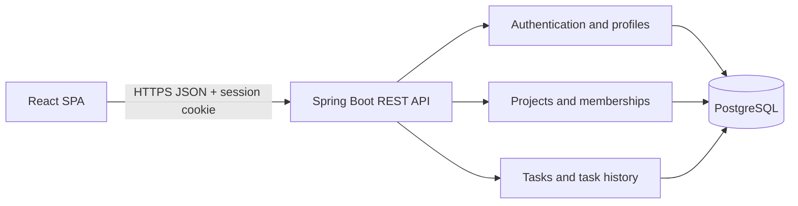

# TeamFlow — Technical reference

## 1. System overview

TeamFlow is a browser-based single-page application backed by a REST API and a relational database. The backend is a Spring Boot modular monolith: controllers handle HTTP, services enforce business rules and authorization, repositories persist entities, and Flyway manages the schema.



The frontend uses Axios with credentials enabled. It requests a CSRF token before mutations and sends the token with POST, PATCH, and DELETE requests. Authentication uses a server-side HTTP session rather than a browser-stored bearer token.

## 2. Technology stack

| Layer | Technologies | Responsibility |
|---|---|---|
| Frontend | React 18, JavaScript, Vite 6, React Router, Axios, Tailwind CSS tooling, Lucide | SPA, navigation, forms, board/list views, charts and responsive styling |
| Backend | Java 21, Spring Boot 3.5, Spring Web, Spring Security, Spring Data JPA, Bean Validation | REST API, sessions/CSRF, authorization, validation, business rules and persistence |
| Database | PostgreSQL 15+, Flyway | Relational data, constraints, indexes and versioned schema migrations |
| API docs | Springdoc OpenAPI / Swagger UI | Interactive API reference at `/swagger-ui.html` |
| Frontend checks | Vitest, Testing Library, jsdom, ESLint | Component tests and static analysis |
| Backend checks | JUnit 5, Mockito, Spring Security Test | Unit/controller and authorization-oriented tests |
| Runtime packaging | Docker, Maven Wrapper, npm | Reproducible API image and frontend build |
| Hosting configuration | Render Blueprint, Neon PostgreSQL | Static frontend, Docker API service, managed PostgreSQL |

Dependency versions are pinned or locked in `backend/pom.xml`, `frontend/package-lock.json`, and the frontend manifest. Consult those files for the precise patch version in a given checkout.

## 3. API conventions

- Base path: `/api/v1` (except the public health endpoint `/api/health`).
- Data format: JSON for request and response bodies.
- Authentication: HTTP session cookie; authenticated endpoints are marked below.
- CSRF: call `GET /api/v1/auth/csrf`, then send the returned token as `X-XSRF-TOKEN` for state-changing requests. The browser client handles this.
- Validation errors: HTTP 400 with `code`, `message`, and, when applicable, a `fields` object.
- Authentication/authorization errors: HTTP 401 or 403 with a safe `code` and `message`.
- Conflicting writes: HTTP 409. Task edits include the current `version` to detect stale updates.
- OpenAPI: `/v3/api-docs`; Swagger UI: `/swagger-ui.html`.

### Authentication and account

| Method | Route | Access | Purpose |
|---|---|---|---|
| GET | `/api/v1/auth/csrf` | Public | Obtain a CSRF token for subsequent mutations. |
| POST | `/api/v1/auth/register` | Public + CSRF | Create an account. Body: `name`, `email`, `password` (10–72 characters). |
| POST | `/api/v1/auth/login` | Public + CSRF | Authenticate and establish a session. Body: `email`, `password`. |
| POST | `/api/v1/auth/logout` | Signed in + CSRF | Invalidate the current session. |
| GET | `/api/v1/auth/me` | Signed in | Return the current account's `id`, `name`, and `email`. |
| PATCH | `/api/v1/users/me` | Signed in + CSRF | Update profile name/email and optionally password. Current password is required when changing email or password. |

### Projects, membership, overview, and analytics

All project routes require authentication and project membership, except `POST /api/v1/projects`, which creates a project for the signed-in user. The creator becomes its owner.

| Method | Route | Access | Purpose |
|---|---|---|---|
| GET | `/api/v1/projects` | Signed in | List projects the current user belongs to. |
| POST | `/api/v1/projects` | Signed in + CSRF | Create a project. Body: `name`, optional `description`. |
| GET | `/api/v1/projects/{id}` | Project member | Read project details and the caller's role. |
| PATCH | `/api/v1/projects/{id}` | Owner + CSRF | Update project name/description. |
| GET | `/api/v1/projects/{id}/members` | Project member | List members and roles. |
| POST | `/api/v1/projects/{id}/members` | Owner/admin + CSRF | Add an existing user by email and assign `ADMIN` or `MEMBER`. |
| PATCH | `/api/v1/projects/{id}/members/{userId}` | Owner/admin + CSRF | Change a member's role. Owner transfer is not supported. |
| DELETE | `/api/v1/projects/{id}/members/{userId}` | Owner/admin + CSRF | Remove a member. The owner cannot be removed. |
| GET | `/api/v1/projects/{id}/overview` | Project member | Return current counts, status totals, due-date metrics, and recently updated tasks. |
| GET | `/api/v1/projects/{id}/analytics?from=YYYY-MM-DD&to=YYYY-MM-DD` | Project member | Return date-bounded trends and task breakdowns. Defaults to the latest 30 days; maximum range is 366 days. |

### Tasks

All task endpoints require membership in the task's project. A task assignee must also be a member of that project.

| Method | Route | Purpose |
|---|---|---|
| GET | `/api/v1/projects/{projectId}/tasks` | List/search/filter/sort tasks. Supports `status`, `priority`, `assigneeId`, `search`, `page`, `size` (1–100), `sort`, and `direction`. |
| POST | `/api/v1/projects/{projectId}/tasks` | Create a task with title, optional description, priority, assignee, and due date. New tasks start in `TODO`. |
| GET | `/api/v1/tasks/{id}` | Read task details. |
| PATCH | `/api/v1/tasks/{id}` | Update title, description, priority, assignee, or due date. Include `version`. |
| PATCH | `/api/v1/tasks/{id}/status` | Change task status. Include target `status` and `version`. |
| GET | `/api/v1/tasks/{id}/history` | Read task audit events. |

Statuses are `TODO`, `IN_PROGRESS`, `IN_REVIEW`, and `DONE`; priorities are `LOW`, `MEDIUM`, `HIGH`, and `URGENT`. The current API permits moving a task to any different status. Re-selecting its current status is rejected. Status changes and their audit entries are written in one transaction.

### Health

| Method | Route | Access | Purpose |
|---|---|---|---|
| GET | `/api/health` | Public | Simple service health response used by the deployment health check. |

## 4. Authorization model

- New projects are owned by their creator, who is also added to `project_members` with role `OWNER`.
- Only project members can list or access that project's tasks, members, overview, or analytics.
- Owners can edit project details. Owners and admins can add/remove members and update roles.
- Members can create and update tasks. A task may only be assigned to a project member.
- Ownership transfer, project deletion, and task deletion are not implemented.
- Passwords are stored as BCrypt hashes (cost 12). Login changes the session ID; session cookies are HttpOnly. CSRF protection is enabled.

## 5. Data model

The database has five application tables. See [database design](database.md) for the relationship diagram and column details.

| Table | Purpose | Important integrity rules |
|---|---|---|
| `users` | Account identity and BCrypt password hash. | Unique email. |
| `projects` | Project name, description, and owner. | `owner_id` references `users`. |
| `project_members` | User access and role per project. | Composite primary key `(project_id, user_id)`; roles are OWNER, ADMIN, MEMBER. |
| `tasks` | Project task, status, priority, creator, assignee, dates, and version. | Project/user foreign keys; status and priority checks; `version` provides optimistic locking. |
| `audit_logs` | Task creation, details updates, and status changes. | References project, task, and actor; before/after values are stored as JSON text. |

Flyway currently applies `V1__initial_schema.sql`. The analytics endpoints query the task and audit tables; they do not add analytics-specific tables. Completion trend buckets count each task once in the selected range and attribute it to its first Done event within that range.

## 6. Local checks

```bash
cd backend
./mvnw test
./mvnw package
```

```bash
cd frontend
npm ci
npm run lint
npm test
npm run build
```

The backend requires a reachable PostgreSQL database when run as an application. Unit/controller tests are run separately from deployment and do not provision hosted services.

## 7. Configuration

| Variable | Used by | Meaning |
|---|---|---|
| `DB_URL` | Backend | JDBC PostgreSQL URL. Use SSL for hosted database connections. |
| `DB_USERNAME` / `DB_PASSWORD` | Backend | Database role credentials. Store as host secrets. |
| `DEMO_USER_PASSWORD` | Backend | Required only when the opt-in `demo` profile creates missing accounts; provide as a secret, never commit it. |
| `FRONTEND_ORIGIN` | Backend | Exact allowed frontend origin for credentialed CORS requests. |
| `COOKIE_SECURE` | Backend | Set `true` for HTTPS deployment; `false` is for local HTTP only. |
| `PORT` | Backend | HTTP listen port; Render injects this at runtime. |
| `VITE_API_BASE_URL` | Frontend build | Public API origin embedded in the static frontend build. |
| `SPRING_PROFILES_ACTIVE` | Backend | Set to `demo` only when intentionally creating missing demo login accounts. |

Never commit `.env` files, hosted database credentials, demo passwords, or database exports. The repository ignores `.env` files and database dump files and provides placeholder-only `.env.example` templates. The default deployment does not enable the demo seeder; the sample database is imported separately.
